# Exception and Validation Class Diagram

This diagram shows the new exception hierarchy (`GameZoneException` and
its four subclasses), the three validators with their methods, how the
refactored services and persistence classes use them, and how
`ConsoleUI` (the specification's `ConsoleMenu`) handles each type of
exception. `ProductPersistence`, `PersonPersistence`, and
`SalePersistence` are the specification's `ProductRepository`,
`PersonRepository`, and `SaleRepository`. Classes of the system not
involved in this change are omitted; see `integrated-class-diagram.md`
for the complete system.

```mermaid
classDiagram
    direction TB

    namespace exceptions {
        class RuntimeException {
            <<Java>>
        }

        class GameZoneException {
            <<abstract>>
            -String errorCode
            #GameZoneException(String message)
            #GameZoneException(String message, String errorCode)
            +getErrorCode() String
        }

        class ResourceNotFoundException {
            -String resourceType
            -String resourceId
            +ResourceNotFoundException(String resourceType, String resourceId)
            +getResourceType() String
            +getResourceId() String
        }

        class BusinessRuleException {
            +BusinessRuleException(String message)
        }

        class InvalidDataException {
            -String fieldName
            +InvalidDataException(String fieldName, String problem)
            +getFieldName() String
        }

        class PersistenceException {
            +PersistenceException(String message, Throwable cause)
        }
    }

    namespace validation {
        class ProductValidator {
            <<utility>>
            +validateProductData(String id, String title, double price, int stock)$ void
            +validateStockAvailability(Product product, int requestedQuantity)$ void
            +validateProductExists(Product product, String productId)$ void
        }

        class PersonValidator {
            <<utility>>
            +validatePersonData(String id, String name, String email, String phone)$ void
            +validateSellerData(String employeeCode, String shift)$ void
            +validatePersonExists(Person person, String personId)$ void
            +validateUniquePerson(List~Person~ existing, String newId)$ void
            -requireText(String fieldName, String value)$ void
        }

        class SaleValidator {
            <<utility>>
            +validateSaleData(Client client, Seller seller, List~Product~ products)$ void
            +validateSaleData(Client client, Seller seller, List~Product~ products, List~Accessory~ accessories)$ void
            +validateSaleExists(Sale sale, String saleId)$ void
        }
    }

    namespace service {
        class ProductService {
            +registerProduct(Product product) void
            +findById(String productId) Product
            +getProductById(String productId) Product
            +reduceStock(String productId, int amount) boolean
            +restoreStock(String productId, int quantity) boolean
        }

        class PersonService {
            +registerClient(String id, String name, String phone, String email) void
            +registerSeller(String id, String name, String phone, String employeeCode, String shift) void
            +findById(String id) Person
            +getClientById(String id) Client
            +getSellerById(String id) Seller
        }

        class SaleService {
            +registerSale(Client, Seller, List~Product~) Sale
            +registerSale(Client, Seller, List~Product~, List~Accessory~, List~String~) Sale
            +registerSaleByItemIds(Client, Seller, List~String~, List~String~) Sale
            -processSale(...) Sale
            +findById(String saleId) Sale
            +getSaleById(String saleId) Sale
        }
    }

    namespace persistence {
        class ProductPersistence {
            -String FILE_PATH = "data/products.txt"
            +save(List~Product~ products) void
            +load() List~Product~
            -parseLine(String line) Product
        }

        class PersonPersistence {
            -String FILE_PATH = "data/persons.txt"
            +save(List~Person~ people) void
            +load() List~Person~
            -parseLine(String line) Person
        }

        class SalePersistence {
            -String FILE_PATH = "data/sales.txt"
            +save(List~Sale~ sales) void
            +load() List~Sale~
            -parseLine(String line, ...) Sale
        }
    }

    namespace ui {
        class ConsoleUI {
            -executeOperation(Runnable operation) void
            -accessoryFileError(IOException cause) PersistenceException
            -registerSale() void
            -registerClient() void
            -registerReturn() void
        }

        class Main {
            +main(String[] args)$ void
            -createConsoleUI()$ ConsoleUI
        }
    }

%% Exception hierarchy
    RuntimeException <|-- GameZoneException
    GameZoneException <|-- ResourceNotFoundException
    GameZoneException <|-- BusinessRuleException
    GameZoneException <|-- InvalidDataException
    GameZoneException <|-- PersistenceException

%% Validators throw the custom exceptions
    ProductValidator ..> InvalidDataException : throws
    ProductValidator ..> BusinessRuleException : throws
    ProductValidator ..> ResourceNotFoundException : throws
    PersonValidator ..> InvalidDataException : throws
    PersonValidator ..> BusinessRuleException : throws
    PersonValidator ..> ResourceNotFoundException : throws
    SaleValidator ..> InvalidDataException : throws
    SaleValidator ..> BusinessRuleException : throws
    SaleValidator ..> ResourceNotFoundException : throws

%% Services call the validators before each operation
    ProductService ..> ProductValidator : validates with
    PersonService ..> PersonValidator : validates with
    SaleService ..> SaleValidator : validates with
    SaleService ..> ProductValidator : validates stock with
    ProductService ..> InvalidDataException : throws
    SaleService ..> BusinessRuleException : throws
    SaleService ..> ResourceNotFoundException : throws
    SaleService ..> PersistenceException : wraps IOException
    PersonService ..> ResourceNotFoundException : throws
    SaleService --> ProductService

%% Services use the persistence classes
    ProductService --> ProductPersistence
    PersonService --> PersonPersistence
    SaleService --> SalePersistence

%% Persistence wraps IOException
    ProductPersistence ..> PersistenceException : wraps IOException
    PersonPersistence ..> PersistenceException : wraps IOException
    SalePersistence ..> PersistenceException : wraps IOException

%% Differentiated handling in the user interface
    ConsoleUI --> ProductService
    ConsoleUI --> PersonService
    ConsoleUI --> SaleService
    ConsoleUI ..> ResourceNotFoundException : catch
    ConsoleUI ..> BusinessRuleException : catch
    ConsoleUI ..> InvalidDataException : catch
    ConsoleUI ..> PersistenceException : catch
    Main ..> PersistenceException : catch at startup
    Main ..> ConsoleUI : creates
```

## Reading the diagram

- **Hierarchy.** `GameZoneException` is abstract and extends
  `RuntimeException` (unchecked), so no method has to declare it. Each
  subclass sets its own error code (`RESOURCE_NOT_FOUND`,
  `BUSINESS_RULE`, `INVALID_DATA`, `PERSISTENCE`) and builds its message
  in Spanish. `PersistenceException` keeps the original `IOException` as
  its cause.
- **Validators.** They are utility classes with static methods and a
  private constructor. They depend only on the model and the exceptions:
  they never call services or persistence classes. Everything they need
  is passed as a parameter.
- **Services.** They call the validators before changing anything. The
  `findById` methods still return `null`; the new `get...ById` methods
  throw `ResourceNotFoundException`. `SaleService` turns the
  `IOException` of the accessory stock into a `PersistenceException`, so
  it no longer declares `throws IOException`.
- **Persistence.** Every `IOException` and every line that cannot be
  parsed becomes a `PersistenceException` whose message names the file
  and the operation (reading or writing).
- **User interface.** Every option of every submenu runs through
  `executeOperation`, a single `try` with one `catch` clause per
  exception type, plus a clause for the standard exceptions of the other
  modules and a final clause for unexpected errors. `Main` catches the
  errors that happen while the data is loaded at startup.
- **Model.** Not shown in detail: `Product`, `Accessory`, `Cable`, and
  `Memory` throw `InvalidDataException` when created with a negative
  price or stock, or a non-positive length or capacity.