# GRASP Class Diagram — Before and After the Corrections

Class diagrams of Requirement 7, Phase 2, written in Mermaid. They show the
classes involved in the nine violations of the consolidated audit
(`docs/grasp-audit/consolidated-audit.md`), with the attributes, methods,
and relations relevant to each violation. A note next to each class gives
the identifiers of the violations (V-XX) that changed it. Classes of the
system not involved in any violation are omitted; see
`integrated-class-diagram.md` and `exception-class-diagram.md` for the
complete system.

Names used in the code: `ProductPersistence` and `PersonPersistence` are
the specification's `ProductRepository` and `PersonRepository`, `Client`
is `Customer`, and `ConsoleUI` is `ConsoleMenu`.

## Before (develop, commit `44d8f9e`)

The dashed arrows labeled `instanceof` mark the type checks that the audit
found.

```mermaid
classDiagram
    direction TB

    namespace model {
        class Product {
            <<abstract>>
            -String id
            -String title
            -double price
            -int stock
            +getStock() int
            +setStock(int stock) void
            +getDescription()* String
        }
        class VideoGame {
            -String platform
            -String genre
            -String ageRating
        }
        class Console {
            -String brand
            -String model
            -String generation
        }
        class Accessory {
            <<abstract>>
            -String id
            -String title
            -double price
            -int stock
            +getStock() int
            +setStock(int stock) void
            +getType()* String
        }
        class Controller {
            -ConnectionType connectionType
            -List~String~ compatibleConsoleIds
            +getCompatibleConsoleIds() List~String~
            +addCompatibleConsole(String consoleId) void
            +isCompatibleWith(String consoleId) boolean
        }
        class Memory {
            -int capacityInGB
            -MemoryType memoryType
            -List~String~ compatibleConsoleIds
            +getCompatibleConsoleIds() List~String~
            +addCompatibleConsole(String consoleId) void
            +isCompatibleWith(String consoleId) boolean
        }
        class Cable {
            -double lengthInMeters
            -String connectorType
        }
        class Person {
            <<abstract>>
        }
        class Client
        class Seller
        class Promotion {
            <<abstract>>
            +calculateDiscount(Sale sale)* double
        }
        class PercentageDiscount
        class BulkPurchaseDiscount
        class CategoryDiscount {
            -double percentage
            -String targetCategory
            -matchesCategory(Product product) boolean
            +calculateDiscount(Sale sale) double
        }
        class Sale {
            -double discountAmount
            -double warrantyCost
            +calculateTotal() double
            +getDiscountAmount() double
            +generateReceipt() String
            -formatAmount(double amount) String
        }
        class Return {
            -Sale originalSale
            -paidFactor() double
            -refundFor(double listPrice) double
            +generateReturnReceipt() String
            -formatAmount(double amount) String
        }
        class Warranty {
            <<abstract>>
            +generateWarrantyCertificate() String
            -formatAmount(double amount) String
        }
        class BasicWarranty
        class ExtendedWarranty
    }

    namespace validation {
        class ProductValidator {
            +validateStockAvailability(Product product, int quantity)$ void
        }
    }

    namespace service {
        class ProductService {
            +reduceStock(String productId, int amount) boolean
            +hasEnoughStock(String productId, int amount) boolean
            +restoreStock(String productId, int quantity) boolean
        }
        class AccessoryService {
            +findAccessoriesCompatibleWith(String consoleId) List~Accessory~
            +hasEnoughStock(String accessoryId, int amount) boolean
            +reduceStock(String accessoryId, int amount) boolean
            +addCompatibleConsole(String accessoryId, String consoleId) boolean
            +restoreStock(String accessoryId, int quantity) boolean
        }
        class PromotionService {
            +registerCategoryDiscount(...) CategoryDiscount
        }
        class SaleService {
            -assignWarranties(Sale sale, List~String~ extendedIds) void
            -containsConsole(List~Product~ products, String productId) boolean
        }
        class WarrantyService {
            -resolveWarranties(List~WarrantyRecord~ records) List~Warranty~
            -validateConsole(Product product) void
        }
        class ReturnService {
            +registerReturn(String saleId, List~String~ itemIds, String reason) Return
        }
    }

    namespace persistence {
        class ProductPersistence {
            -toLine(Product product) String
            -fromLine(String line) Product
        }
        class PersonPersistence {
            -toLine(Person person) String
            -fromLine(String line) Person
        }
        class AccessoryRepository {
            -toLine(Accessory accessory) String
            -fromLine(String line) Accessory
        }
        class PromotionRepository {
            -toLine(Promotion promotion) String
            -fromLine(String line) Promotion
        }
        class WarrantyRepository {
            -toLine(Warranty warranty) String
            -fromLine(String line) WarrantyRecord
        }
    }

    namespace ui {
        class ConsoleUI {
            -Scanner scanner
            +run() void
            -productMenu() void
            -personMenu() void
            -saleMenu() void
            -accessoryMenu() void
            -promotionMenu() void
            -returnMenu() void
            -warrantyMenu() void
            -executeOperation(Runnable operation) void
            -readOption() int
            -readPrice() Double
            -readDate(String prompt) LocalDate
            -askExtendedWarranties(List~Product~ products) List~String~
            -addCompatibleConsole() void
            -formatAmount(double amount) String
        }
    }

    Product <|-- VideoGame
    Product <|-- Console
    Accessory <|-- Controller
    Accessory <|-- Memory
    Accessory <|-- Cable
    Person <|-- Client
    Person <|-- Seller
    Promotion <|-- PercentageDiscount
    Promotion <|-- CategoryDiscount
    Promotion <|-- BulkPurchaseDiscount
    Warranty <|-- BasicWarranty
    Warranty <|-- ExtendedWarranty
    Return --> Sale : originalSale
    CategoryDiscount ..> VideoGame : instanceof
    CategoryDiscount ..> Console : instanceof
    ProductService ..> ProductPersistence
    ProductService ..> ProductValidator
    SaleService ..> Console : instanceof
    WarrantyService ..> Console : instanceof
    ReturnService ..> Console : instanceof
    AccessoryService ..> Controller : instanceof
    AccessoryService ..> Memory : instanceof
    WarrantyService ..> WarrantyRepository
    ConsoleUI ..> Console : instanceof
    ConsoleUI ..> Controller : instanceof
    ConsoleUI ..> Memory : instanceof

    note for ProductService "V-01: reduceStock, hasEnoughStock and restoreStock\nread and write the stock of Product.\nV-01 (leader): restoreStock"
    note for AccessoryService "V-01: stock handled outside Accessory\nV-04: instanceof Controller / Memory"
    note for ProductValidator "V-01: compares getStock() itself"
    note for Return "V-02: paidFactor uses the subtotal and discount of Sale\nV-09: duplicated formatAmount"
    note for Sale "V-09: duplicated formatAmount"
    note for Warranty "V-09: duplicated formatAmount"
    note for CategoryDiscount "V-03: category found with instanceof and text literals"
    note for PromotionService "V-03: list of categories repeated"
    note for Controller "V-04: compatibility code duplicated in Memory"
    note for Memory "V-04: compatibility code duplicated in Controller"
    note for SaleService "V-05: instanceof Console"
    note for WarrantyService "V-05: instanceof Console\nV-07: warranty type chosen by its code"
    note for ReturnService "V-05: instanceof Console"
    note for ProductPersistence "V-06: format chosen with instanceof and type codes"
    note for PersonPersistence "V-07: format chosen with instanceof and type codes"
    note for AccessoryRepository "V-07: format chosen with instanceof and type codes"
    note for PromotionRepository "V-07: format chosen with instanceof and type codes"
    note for WarrantyRepository "V-07: BASIC or EXTENDED chosen with instanceof"
    note for ConsoleUI "V-04, V-05: instanceof checks\nV-08: 1,479 lines, 7 submenus, input and errors\nV-09: duplicated formatAmount"
```

## After (end of Phase 2)

New classes: `ConsoleCompatibleAccessory` (model), `CurrencyFormatter`
(new package `com.gamezone.util`), and `ConsoleInput`, `ErrorHandler`,
`ProductMenu`, `PersonMenu`, `SaleMenu`, `AccessoryMenu`, `PromotionMenu`,
`ReturnMenu`, and `WarrantyMenu` (ui). No class was removed. Every submenu
uses `ConsoleInput` and `ErrorHandler`; the diagram draws those relations
only for `SaleMenu` to keep it readable.

```mermaid
classDiagram
    direction TB

    namespace model {
        class Product {
            <<abstract>>
            -int stock
            +hasEnoughStock(int amount) boolean
            +decreaseStock(int amount) void
            +increaseStock(int amount) void
            +getCategory()* String
            +isWarrantyEligible() boolean
        }
        class VideoGame {
            +getCategory() String
        }
        class Console {
            +getCategory() String
            +isWarrantyEligible() boolean
        }
        class Accessory {
            <<abstract>>
            -int stock
            +hasEnoughStock(int amount) boolean
            +decreaseStock(int amount) void
            +increaseStock(int amount) void
            +getCategory() String
        }
        class ConsoleCompatibleAccessory {
            <<abstract>>
            -List~String~ compatibleConsoleIds
            +getCompatibleConsoleIds() List~String~
            +addCompatibleConsole(String consoleId) void
            +isCompatibleWith(String consoleId) boolean
        }
        class Controller {
            -ConnectionType connectionType
        }
        class Memory {
            -int capacityInGB
            -MemoryType memoryType
        }
        class Cable {
            -double lengthInMeters
            -String connectorType
        }
        class Person {
            <<abstract>>
        }
        class Client
        class Seller
        class Promotion {
            <<abstract>>
            +calculateDiscount(Sale sale)* double
        }
        class PercentageDiscount
        class BulkPurchaseDiscount
        class CategoryDiscount {
            -List~String~ SUPPORTED_CATEGORIES$
            -String targetCategory
            +isSupportedCategory(String category)$ boolean
            +calculateDiscount(Sale sale) double
        }
        class Sale {
            -double discountAmount
            +calculateTotal() double
            +calculatePaidRatio() double
            +generateReceipt() String
        }
        class Return {
            -Sale originalSale
            -refundFor(double listPrice) double
            +generateReturnReceipt() String
        }
        class Warranty {
            <<abstract>>
            +generateWarrantyCertificate() String
        }
        class BasicWarranty
        class ExtendedWarranty
    }

    namespace util {
        class CurrencyFormatter {
            <<final>>
            -CurrencyFormatter()
            +format(double amount)$ String
        }
    }

    namespace validation {
        class ProductValidator {
            +validateStockAvailability(Product product, int quantity)$ void
        }
    }

    namespace service {
        class ProductService {
            +reduceStock(String productId, int amount) boolean
            +hasEnoughStock(String productId, int amount) boolean
            +restoreStock(String productId, int quantity) boolean
        }
        class AccessoryService {
            +findAccessoriesCompatibleWith(String consoleId) List~Accessory~
            +reduceStock(String accessoryId, int amount) boolean
            +addCompatibleConsole(String accessoryId, String consoleId) boolean
            +restoreStock(String accessoryId, int quantity) boolean
        }
        class PromotionService {
            +registerCategoryDiscount(...) CategoryDiscount
        }
        class SaleService {
            -assignWarranties(Sale sale, List~String~ extendedIds) void
            -containsWarrantyEligibleProduct(List~Product~ products, String productId) boolean
        }
        class WarrantyService {
            -resolveWarranties(List~WarrantyRecord~ records) List~Warranty~
            -validateWarrantyEligible(Product product) void
        }
        class ReturnService {
            +registerReturn(String saleId, List~String~ itemIds, String reason) Return
        }
    }

    namespace persistence {
        class ProductPersistence {
            -Map writers
            -Map readers
            -registerFormat(Class type, String code, Function fields, ProductReader reader) void
        }
        class PersonPersistence {
            -Map writers
            -Map readers
            -registerFormat(Class type, String code, Function fields, PersonReader reader) void
        }
        class AccessoryRepository {
            -Map writers
            -Map readers
            -registerFormat(Class type, String code, Function fields, AccessoryReader reader) void
        }
        class PromotionRepository {
            -Map writers
            -Map readers
            -registerFormat(Class type, String code, Function fields, PromotionReader reader) void
        }
        class WarrantyRepository {
            -Map codes
            -Map factories
            -registerType(Class type, String code, WarrantyFactory factory) void
            +toWarranty(WarrantyRecord record, Product product, Sale sale) Warranty
        }
    }

    namespace ui {
        class ConsoleUI {
            +run() void
            -showMainMenu() void
        }
        class ConsoleInput {
            -Scanner scanner
            +readLine() String
            +readOption() int
            +readPrice() Double
            +readStock() Integer
            +readPercentage() Double
            +readDate(String prompt) LocalDate
            +close() void
        }
        class ErrorHandler {
            +executeOperation(Runnable operation) void
        }
        class ProductMenu {
            +show() void
        }
        class PersonMenu {
            +show() void
        }
        class SaleMenu {
            +show() void
        }
        class AccessoryMenu {
            +show() void
        }
        class PromotionMenu {
            +show() void
        }
        class ReturnMenu {
            +show() void
        }
        class WarrantyMenu {
            +show() void
        }
    }

    Product <|-- VideoGame
    Product <|-- Console
    Accessory <|-- ConsoleCompatibleAccessory
    ConsoleCompatibleAccessory <|-- Controller
    ConsoleCompatibleAccessory <|-- Memory
    Accessory <|-- Cable
    Person <|-- Client
    Person <|-- Seller
    Promotion <|-- PercentageDiscount
    Promotion <|-- CategoryDiscount
    Promotion <|-- BulkPurchaseDiscount
    Warranty <|-- BasicWarranty
    Warranty <|-- ExtendedWarranty
    Return --> Sale : originalSale
    CategoryDiscount ..> Product : getCategory()
    CategoryDiscount ..> Accessory : getCategory()
    PromotionService ..> CategoryDiscount : isSupportedCategory()
    ProductService ..> ProductPersistence
    ProductService ..> ProductValidator
    ProductService ..> Product : stock operations
    ProductValidator ..> Product : hasEnoughStock()
    AccessoryService ..> ConsoleCompatibleAccessory
    AccessoryService ..> Accessory : stock operations
    SaleService ..> Product : isWarrantyEligible()
    WarrantyService ..> Product : isWarrantyEligible()
    ReturnService ..> Product : isWarrantyEligible()
    WarrantyService ..> WarrantyRepository
    Sale ..> CurrencyFormatter
    Return ..> CurrencyFormatter
    Warranty ..> CurrencyFormatter
    ConsoleUI --> ConsoleInput
    ConsoleUI --> ProductMenu
    ConsoleUI --> PersonMenu
    ConsoleUI --> SaleMenu
    ConsoleUI --> AccessoryMenu
    ConsoleUI --> PromotionMenu
    ConsoleUI --> ReturnMenu
    ConsoleUI --> WarrantyMenu
    SaleMenu --> ConsoleInput
    SaleMenu --> ErrorHandler
    SaleMenu ..> CurrencyFormatter
    SaleMenu ..> Product : isWarrantyEligible()
    AccessoryMenu ..> ConsoleCompatibleAccessory
    ReturnMenu ..> CurrencyFormatter
    WarrantyMenu ..> CurrencyFormatter

    note for Product "V-01: stock operations\nV-03: getCategory()\nV-05: isWarrantyEligible()"
    note for Accessory "V-01: stock operations\nV-03: getCategory()"
    note for ConsoleCompatibleAccessory "V-04: new class with the compatibility\nlist of Controller and Memory"
    note for Sale "V-02: calculatePaidRatio()\nV-09: uses CurrencyFormatter"
    note for Return "V-02: asks Sale for the paid ratio\nV-09: uses CurrencyFormatter"
    note for Warranty "V-09: uses CurrencyFormatter"
    note for CurrencyFormatter "V-09: new class"
    note for CategoryDiscount "V-03: compares getCategory();\nisSupportedCategory()"
    note for PromotionService "V-03: asks CategoryDiscount"
    note for ProductService "V-01: Product handles its stock"
    note for AccessoryService "V-01: Accessory handles its stock\nV-04: asks for ConsoleCompatibleAccessory"
    note for SaleService "V-05: isWarrantyEligible()"
    note for WarrantyService "V-05: isWarrantyEligible()\nV-07: WarrantyRepository creates each type"
    note for ReturnService "V-05: isWarrantyEligible()"
    note for ProductPersistence "V-06: one registered format per type"
    note for PersonPersistence "V-07: one registered format per type"
    note for AccessoryRepository "V-07: one registered format per type"
    note for PromotionRepository "V-07: one registered format per type"
    note for WarrantyRepository "V-07: one registered code and factory per type"
    note for ConsoleUI "V-08: only the main menu"
    note for ConsoleInput "V-08: new class"
    note for ErrorHandler "V-08: new class"
    note for ProductMenu "V-08: new class"
    note for PersonMenu "V-08: new class"
    note for SaleMenu "V-08: new class\nV-05: isWarrantyEligible()"
    note for AccessoryMenu "V-08: new class\nV-04: ConsoleCompatibleAccessory"
    note for PromotionMenu "V-08: new class"
    note for ReturnMenu "V-08: new class"
    note for WarrantyMenu "V-08: new class"
```

