# Integrated Class Diagram

This diagram shows the complete GameZone Unicesar system after the
integration of Requirement 5: the base system of the workshop and the
four modules (accessories, promotions, returns, and warranties), organized
in the four layers `ui`, `service`, `persistence`, and `model`.

To keep the diagram readable:
- Simple getters and setters, `toString`, `equals`, and `hashCode` are
  omitted. Every attribute is private and is accessed through its getter
  (and setter, when the class allows changing it).
- Overloaded constructors kept only for backward compatibility (for
  example, the shorter constructors of `SaleService`, `ReturnService`, and
  `ConsoleUI`) are omitted; only the constructor used by `Main` is shown.
- The module diagrams (`class-diagram.md`, `accessory-class-diagram.md`,
  `promotion-class-diagram.md`, `return-class-diagram.md`, and
  `warranty-class-diagram.md`) show each module in more detail.

`SalePersistence` plays the role of the `SaleRepository` named in the
specification, and `ConsoleUI` plays the role of `ConsoleMenu`.

```mermaid
classDiagram
    direction TB

    namespace ui {
        class ConsoleUI {
            -ProductService productService
            -PersonService personService
            -SaleService saleService
            -AccessoryService accessoryService
            -PromotionService promotionService
            -ReturnService returnService
            -WarrantyService warrantyService
            -Scanner scanner
            +ConsoleUI(ProductService, PersonService, SaleService, AccessoryService, PromotionService, ReturnService, WarrantyService)
            +run() void
        }
    }

    namespace service {
        class ProductService {
            -ProductPersistence productPersistence
            -List~Product~ products
            +registerProduct(Product product) void
            +listAll() List~Product~
            +findById(String productId) Product
            +hasEnoughStock(String productId, int amount) boolean
            +reduceStock(String productId, int amount) boolean
            +restoreStock(String productId, int quantity) boolean
        }

        class PersonService {
            -PersonPersistence personPersistence
            -List~Person~ people
            +registerClient(String id, String name, String phone, String email) void
            +registerSeller(String id, String name, String phone, String employeeCode, String shift) void
            +listClient() List~Client~
            +listSeller() List~Seller~
            +findById(String id) Person
        }

        class AccessoryService {
            -AccessoryRepository accessoryRepository
            -List~Accessory~ accessories
            +registerController(...) Controller
            +registerCable(...) Cable
            +registerMemory(...) Memory
            +listAllAccessories() List~Accessory~
            +listAccessoriesByType(String type) List~Accessory~
            +findAccessoriesCompatibleWith(String consoleId) List~Accessory~
            +findById(String id) Accessory
            +updateStock(String accessoryId, int quantity) boolean
            +hasEnoughStock(String accessoryId, int amount) boolean
            +reduceStock(String accessoryId, int amount) boolean
            +restoreStock(String accessoryId, int quantity) boolean
            +addCompatibleConsole(String accessoryId, String consoleId) boolean
        }

        class PromotionService {
            -PromotionRepository promotionRepository
            -List~Promotion~ promotions
            +registerPercentageDiscount(...) PercentageDiscount
            +registerCategoryDiscount(...) CategoryDiscount
            +registerBulkPurchaseDiscount(...) BulkPurchaseDiscount
            +listAllPromotions() List~Promotion~
            +listActivePromotions() List~Promotion~
            +findBestPromotionFor(Sale sale) Promotion
            +findById(String id) Promotion
        }

        class SaleService {
            -SalePersistence salePersistence
            -ProductService productService
            -AccessoryService accessoryService
            -PromotionService promotionService
            -WarrantyService warrantyService
            -List~Sale~ sales
            +SaleService(ProductService, AccessoryService, SalePersistence, PromotionService, WarrantyService)
            +registerSale(Client, Seller, List~Product~, List~Accessory~, List~String~ extendedWarrantyIds) Sale
            +registerSaleByItemIds(Client, Seller, List~String~ itemIds, List~String~ extendedWarrantyIds) Sale
            -processSale(...) Sale
            -applyBestPromotion(Sale sale) void
            -assignWarranties(Sale sale, List~String~ extendedIds) void
            +listAll() List~Sale~
            +findById(String saleId) Sale
            +findByClient(String clientId) List~Sale~
            +findBySeller(String sellerId) List~Sale~
        }

        class WarrantyService {
            -WarrantyRepository warrantyRepository
            -SalePersistence salePersistence
            -ProductService productService
            -List~Warranty~ warranties
            +WarrantyService(WarrantyRepository, SalePersistence, ProductService)
            +assignBasicWarranty(Product, Sale, LocalDate) BasicWarranty
            +assignExtendedWarranty(Product, Sale, LocalDate) ExtendedWarranty
            +findWarrantyByProduct(String productId, String saleId) Warranty
            +cancelWarranties(String productId, String saleId) double
            +listAllWarranties() List~Warranty~
            +listActiveWarranties() List~Warranty~
            +listWarrantiesExpiringSoon(int daysAhead) List~Warranty~
            -resolveWarranties(List~WarrantyRecord~ records) List~Warranty~
        }

        class ReturnService {
            -ReturnRepository returnRepository
            -SaleService saleService
            -ProductService productService
            -AccessoryService accessoryService
            -WarrantyService warrantyService
            -List~Return~ returns
            +ReturnService(ReturnRepository, SaleService, ProductService, AccessoryService, WarrantyService)
            +registerReturn(String saleId, List~String~ itemIds, String reason) Return
            +viewAllReturns() List~Return~
            +viewReturnsByCustomer(String customerId) List~Return~
            +viewReturnsBySale(String saleId) List~Return~
            +calculateMonthlySales(int month, int year) double
            +calculateMonthlyReturns(int month, int year) double
            +generateMonthlyBalance(int month, int year) double
            -resolveReturns(List~ReturnRecord~ records) List~Return~
        }
    }

    namespace persistence {
        class ProductPersistence {
            +save(List~Product~ products) void
            +load() List~Product~
        }

        class PersonPersistence {
            +save(List~Person~ people) void
            +load() List~Person~
        }

        class AccessoryRepository {
            +saveAll(List~Accessory~ accessories) void
            +loadAll() List~Accessory~
        }

        class PromotionRepository {
            +saveAll(List~Promotion~ promotions) void
            +loadAll() List~Promotion~
        }

        class SalePersistence {
            -ProductPersistence productPersistence
            -PersonPersistence personPersistence
            -AccessoryRepository accessoryRepository
            +save(List~Sale~ sales) void
            +load() List~Sale~
        }

        class WarrantyRepository {
            +saveAll(List~Warranty~ warranties) void
            +loadAll() List~WarrantyRecord~
        }

        class WarrantyRecord {
            <<record>>
            String type
            String id
            String saleId
            String productId
            LocalDate startDate
        }

        class ReturnRepository {
            +saveAll(List~Return~ returns) void
            +loadAll() List~ReturnRecord~
        }

        class ReturnRecord {
            <<record>>
            String id
            LocalDate date
            String saleId
            List~String~ itemIds
            String reason
            double warrantyRefund
        }
    }

    namespace model {
        class Person {
            <<abstract>>
            -String id
            -String name
            -String phone
        }

        class Client {
            -String email
        }

        class Seller {
            -String employeeCode
            -String shift
        }

        class Product {
            <<abstract>>
            -String id
            -String title
            -double price
            -int stock
            +getDescription()* String
        }

        class VideoGame {
            -String platform
            -String genre
            -String ageRating
            +getDescription() String
        }

        class Console {
            -String brand
            -String model
            -String generation
            +getDescription() String
        }

        class Accessory {
            <<abstract>>
            -String id
            -String title
            -double price
            -int stock
            +getType()* String
            +getDescription()* String
        }

        class Controller {
            -ConnectionType connectionType
            -List~String~ compatibleConsoleIds
            +addCompatibleConsole(String consoleId) void
            +isCompatibleWith(String consoleId) boolean
        }

        class Cable {
            -double lengthInMeters
            -String connectorType
        }

        class Memory {
            -int capacityInGB
            -MemoryType memoryType
            -List~String~ compatibleConsoleIds
            +addCompatibleConsole(String consoleId) void
            +isCompatibleWith(String consoleId) boolean
        }

        class Sale {
            -String id
            -LocalDate date
            -Client client
            -Seller seller
            -List~Product~ products
            -List~Accessory~ accessories
            -String appliedPromotionName
            -double discountAmount
            -double warrantyCost
            +calculateTotal() double
            +calculateFinalTotal() double
            +hasDiscount() boolean
            +canBeReturned() boolean
            +generateReceipt() String
        }

        class Promotion {
            <<abstract>>
            -String id
            -String name
            -LocalDate startDate
            -LocalDate endDate
            +isActive(LocalDate date) boolean
            +calculateDiscount(Sale sale)* double
        }

        class PercentageDiscount {
            -double percentage
            +calculateDiscount(Sale sale) double
        }

        class CategoryDiscount {
            -double percentage
            -String targetCategory
            -matchesCategory(Product product) boolean
            +calculateDiscount(Sale sale) double
        }

        class BulkPurchaseDiscount {
            -int minimumQuantity
            -double percentage
            +calculateDiscount(Sale sale) double
        }

        class Warranty {
            <<abstract>>
            -String id
            -Product product
            -Sale sale
            -LocalDate startDate
            -LocalDate endDate
            +getDurationInMonths()* int
            +getWarrantyType()* String
            +getAdditionalCost()* double
            +isActive(LocalDate date) boolean
            +generateWarrantyCertificate() String
        }

        class BasicWarranty {
            +getDurationInMonths() int
            +getWarrantyType() String
            +getAdditionalCost() double
        }

        class ExtendedWarranty {
            +getDurationInMonths() int
            +getWarrantyType() String
            +getAdditionalCost() double
        }

        class Return {
            -String id
            -LocalDate date
            -Sale originalSale
            -List~Product~ returnedProducts
            -List~Accessory~ returnedAccessories
            -String reason
            -double warrantyRefund
            -double refundAmount
            +calculateRefundAmount() double
            -paidFactor() double
            -refundFor(double listPrice) double
            +generateReturnReceipt() String
        }
    }

    %% Inheritance
    Person <|-- Client
    Person <|-- Seller
    Product <|-- VideoGame
    Product <|-- Console
    Accessory <|-- Controller
    Accessory <|-- Cable
    Accessory <|-- Memory
    Promotion <|-- PercentageDiscount
    Promotion <|-- CategoryDiscount
    Promotion <|-- BulkPurchaseDiscount
    Warranty <|-- BasicWarranty
    Warranty <|-- ExtendedWarranty

    %% Associations between model classes
    Sale --> "1" Client : client
    Sale --> "1" Seller : seller
    Sale --> "0..*" Product : products
    Sale --> "0..*" Accessory : accessories
    Warranty --> "1" Product : product
    Warranty --> "1" Sale : sale
    Return --> "1" Sale : originalSale
    Return --> "0..*" Product : returnedProducts
    Return --> "0..*" Accessory : returnedAccessories
    Promotion ..> Sale : calculates discount

    %% ui -> service
    ConsoleUI --> ProductService
    ConsoleUI --> PersonService
    ConsoleUI --> SaleService
    ConsoleUI --> AccessoryService
    ConsoleUI --> PromotionService
    ConsoleUI --> ReturnService
    ConsoleUI --> WarrantyService

    %% service -> service
    SaleService --> ProductService
    SaleService --> AccessoryService
    SaleService --> PromotionService
    SaleService --> WarrantyService
    WarrantyService --> ProductService
    ReturnService --> SaleService
    ReturnService --> ProductService
    ReturnService --> AccessoryService
    ReturnService --> WarrantyService

    %% service -> persistence
    ProductService --> ProductPersistence
    PersonService --> PersonPersistence
    AccessoryService --> AccessoryRepository
    PromotionService --> PromotionRepository
    SaleService --> SalePersistence
    WarrantyService --> WarrantyRepository
    WarrantyService --> SalePersistence
    ReturnService --> ReturnRepository

    %% persistence -> persistence
    SalePersistence --> ProductPersistence
    SalePersistence --> PersonPersistence
    SalePersistence --> AccessoryRepository
    WarrantyRepository ..> WarrantyRecord : creates
    ReturnRepository ..> ReturnRecord : creates
```

## Reading the diagram

- **Model layer.** Four independent hierarchies with abstract base
  classes: `Person`, `Product`, `Accessory`, and `Promotion`, plus the
  `Warranty` hierarchy. `Accessory` does not extend `Product`, so a sale
  keeps two separate lists (`products` and `accessories`). `Controller`
  and `Memory` also declare the nested enums `ConnectionType` and
  `MemoryType`.
- **A sale ties the modules together.** `Sale` stores the applied
  promotion (name and discount) and the cost of extended warranties, and
  calculates `calculateTotal()` (subtotal) and `calculateFinalTotal()`
  (subtotal − discount + warranty cost). `Warranty` and `Return` both
  reference a sale.
- **Service layer.** `SaleService` coordinates the sale flow (A3) through
  `ProductService`, `AccessoryService`, `PromotionService`, and
  `WarrantyService`. `ReturnService` reverts a sale: it restores the stock
  through `ProductService` and `AccessoryService` (A4) and cancels
  warranties through `WarrantyService` (A7).
- **Dependencies only point downwards.** Every arrow goes from `ui` to
  `service`, from `service` to `persistence`, or to `model`; no
  persistence class depends on a service. `WarrantyRepository` and
  `ReturnRepository` store only identifiers and return records
  (`WarrantyRecord`, `ReturnRecord`), and their services resolve them.
- **No circular dependencies (A2).** `WarrantyService` resolves the sale
  of each warranty through `SalePersistence`, not `SaleService`, because
  `SaleService` depends on `WarrantyService`. This lets `Main` build every
  object in order: `ProductService`, `AccessoryService`,
  `PromotionService`, `SalePersistence`, `WarrantyService`, `SaleService`,
  `ReturnService`, and finally `ConsoleUI`.