# Layers Diagram

This diagram represents the architectural organization of the integrated system into four layers and the allowed dependencies between them. It includes the base system of the workshop and the accessory, promotion, return, and warranty modules.

Dependencies only go downwards: `ui → service → persistence → model`. A service can also use other services (for example, `SaleService` uses `PromotionService` and `WarrantyService`), but no class of the persistence layer depends on a service, and the model classes do not depend on any other layer. `WarrantyRepository` and `ReturnRepository` store and load identifiers (`WarrantyRecord` and `ReturnRecord`), and their services resolve them into model objects. To keep the diagram readable, the dependencies of each layer on the model are grouped by module, and the subclasses of the model are listed without arrows; see `integrated-class-diagram.md` for the attributes, methods, and inheritance relationships.

```mermaid
classDiagram
    namespace UI_Layer {
        class ConsoleUI
    }

    namespace Service_Layer {
        class ProductService
        class PersonService
        class SaleService
        class AccessoryService
        class PromotionService
        class ReturnService
        class WarrantyService
    }

    namespace Persistence_Layer {
        class ProductPersistence
        class PersonPersistence
        class SalePersistence
        class AccessoryRepository
        class PromotionRepository
        class ReturnRepository
        class ReturnRecord
        class WarrantyRepository
        class WarrantyRecord
    }

    namespace Model_Layer {
        class Person
        class Client
        class Seller
        class Product
        class VideoGame
        class Console
        class Accessory
        class Controller
        class Cable
        class Memory
        class Sale
        class Promotion
        class PercentageDiscount
        class CategoryDiscount
        class BulkPurchaseDiscount
        class Return
        class Warranty
        class BasicWarranty
        class ExtendedWarranty
    }

    %% UI -> Service
    ConsoleUI ..> ProductService : depends on
    ConsoleUI ..> PersonService : depends on
    ConsoleUI ..> SaleService : depends on
    ConsoleUI ..> AccessoryService : depends on
    ConsoleUI ..> PromotionService : depends on
    ConsoleUI ..> ReturnService : depends on
    ConsoleUI ..> WarrantyService : depends on

    %% Service -> Service
    SaleService ..> ProductService : depends on
    SaleService ..> AccessoryService : depends on
    SaleService ..> PromotionService : depends on
    SaleService ..> WarrantyService : depends on
    WarrantyService ..> ProductService : depends on
    ReturnService ..> SaleService : depends on
    ReturnService ..> ProductService : depends on
    ReturnService ..> AccessoryService : depends on
    ReturnService ..> WarrantyService : depends on

    %% Service -> Persistence
    ProductService ..> ProductPersistence : depends on
    PersonService ..> PersonPersistence : depends on
    SaleService ..> SalePersistence : depends on
    AccessoryService ..> AccessoryRepository : depends on
    PromotionService ..> PromotionRepository : depends on
    ReturnService ..> ReturnRepository : depends on
    WarrantyService ..> WarrantyRepository : depends on
    WarrantyService ..> SalePersistence : depends on

    %% Persistence -> Persistence
    SalePersistence ..> ProductPersistence : depends on
    SalePersistence ..> PersonPersistence : depends on
    SalePersistence ..> AccessoryRepository : depends on
    ReturnRepository ..> ReturnRecord : depends on
    WarrantyRepository ..> WarrantyRecord : depends on

    %% Service -> Model
    ProductService ..> Product : depends on
    PersonService ..> Person : depends on
    SaleService ..> Sale : depends on
    AccessoryService ..> Accessory : depends on
    PromotionService ..> Promotion : depends on
    ReturnService ..> Return : depends on
    WarrantyService ..> Warranty : depends on

    %% Persistence -> Model
    ProductPersistence ..> Product : depends on
    PersonPersistence ..> Person : depends on
    SalePersistence ..> Sale : depends on
    AccessoryRepository ..> Accessory : depends on
    PromotionRepository ..> Promotion : depends on
    ReturnRepository ..> Return : depends on
    WarrantyRepository ..> Warranty : depends on
```

## Layer responsibilities

| Layer | Package | Responsibility |
|---|---|---|
| UI | `com.gamezone.ui` | `ConsoleUI` shows the menus, reads the user's input, and prints results. It only calls services and contains no business rules. |
| Service | `com.gamezone.service` | Business rules and validations: stock, the unified sale flow (A3), the best promotion, warranty assignment and cancellation, returns, and the monthly balance. |
| Persistence | `com.gamezone.persistence` | Reads and writes the files in `data/`. It knows the file format but not the business rules. |
| Model | `com.gamezone.model` | Domain classes and their own calculations (sale totals, promotion discounts, refunds, warranty dates). They do not access files. |

`Main` is the composition root: it creates the objects in dependency
order (`ProductService`, `PersonService`, `AccessoryService`,
`PromotionService`, `SalePersistence`, `WarrantyService`, `SaleService`,
`ReturnRepository`, `ReturnService`, and `ConsoleUI`) and passes each
dependency through the constructors.