# SOLID Class Diagram — Before and After the Corrections

Class diagrams of Requirement 8, Phase 2, written in Mermaid. They show the
classes involved in the seven violations of the consolidated audit
(`docs/solid-audit/consolidated-audit.md`), with the attributes, methods,
and relations relevant to each violation. A note next to each class gives
the identifiers of the violations (V-XX) that change it. Classes of the
system not involved in any violation are omitted; see
`integrated-class-diagram.md` and `grasp-class-diagram.md` for the rest of
the system.

Names used in the code: `ProductPersistence`, `PersonPersistence`, and
`SalePersistence` are the specification's `ProductRepository`,
`PersonRepository`, and `SaleRepository`, and `ConsoleUI` is `ConsoleMenu`.

## Before (develop, commit `6fcea3a`)

The source code is the same as in the audited commit `75cc180`. Arrows
labeled `new` mark the objects that a class creates itself; the other
arrows are dependencies through fields or parameters of a concrete type.

```mermaid
classDiagram
    direction TB

    class Main {
        +main(String[] args)$ void
        -createConsoleUI()$ ConsoleUI
    }

    namespace ui {
        class ConsoleUI {
            -ConsoleInput input
            -ProductMenu productMenu
            -PersonMenu personMenu
            -SaleMenu saleMenu
            -AccessoryMenu accessoryMenu
            -PromotionMenu promotionMenu
            -ReturnMenu returnMenu
            -WarrantyMenu warrantyMenu
            +ConsoleUI(... 3 to 7 services)
            +run() void
            -showMainMenu() void
        }
        class ProductMenu {
            +show() void
        }
        class PersonMenu {
            +show() void
        }
        class PromotionMenu {
            +show() void
        }
        class SaleMenu {
            -SaleService saleService
            -ProductService productService
            -AccessoryService accessoryService
            +show() void
        }
        class AccessoryMenu {
            -AccessoryService accessoryService
            -ProductService productService
            +show() void
        }
        class ReturnMenu {
            -ReturnService returnService
            -SaleService saleService
            +show() void
            -showMonthlyBalance() void
        }
        class WarrantyMenu {
            -WarrantyService warrantyService
            -SaleService saleService
            +show() void
        }
        class ConsoleInput {
            -Scanner scanner
        }
    }

    namespace service {
        class SaleService {
            -SalePersistence salePersistence
            -ProductService productService
            -AccessoryService accessoryService
            +SaleService(ProductService productService)
            +registerSaleByItemIds(...) Sale
            +listAll() List~Sale~
            +findById(String saleId) Sale
            +getSaleById(String saleId) Sale
        }
        class ProductService {
            -ProductPersistence productPersistence
            +ProductService()
            +registerProduct(Product product) void
            +listAll() List~Product~
            +findById(String productId) Product
            +getProductById(String productId) Product
            +reduceStock(String productId, int amount) boolean
            +hasEnoughStock(String productId, int amount) boolean
            +restoreStock(String productId, int quantity) boolean
        }
        class AccessoryService {
            -AccessoryRepository accessoryRepository
            +AccessoryService(AccessoryRepository repository)
            +findById(String id) Accessory
            +hasEnoughStock(String id, int amount) boolean
            +reduceStock(String id, int amount) boolean
            +restoreStock(String id, int quantity) boolean
            +register, list, and compatibility operations ...
        }
        class PersonService {
            -PersonPersistence personPersistence
            +PersonService()
        }
        class PromotionService {
            -PromotionRepository promotionRepository
            +PromotionService(PromotionRepository repository)
        }
        class ReturnService {
            -ReturnRepository returnRepository
            -SaleService saleService
            -ProductService productService
            -AccessoryService accessoryService
            +registerReturn(String saleId, List~String~ ids, String reason) Return
            +viewAllReturns() List~Return~
            +viewReturnsByCustomer(String customerId) List~Return~
            +viewReturnsBySale(String saleId) List~Return~
            +calculateMonthlySales(int month, int year) double
            +calculateMonthlyReturns(int month, int year) double
            +generateMonthlyBalance(int month, int year) double
            -validateMonth(int month) void
        }
        class WarrantyService {
            -WarrantyRepository warrantyRepository
            -SalePersistence salePersistence
            -ProductService productService
        }
    }

    namespace persistence {
        class SalePersistence {
            -ProductPersistence productPersistence
            -PersonPersistence personPersistence
            -AccessoryRepository accessoryRepository
            +SalePersistence()
            +SalePersistence(AccessoryRepository repository)
            +save(List~Sale~ sales) void
            +load() List~Sale~
        }
        class ProductPersistence {
            +save(List~Product~ products) void
            +load() List~Product~
        }
        class PersonPersistence {
            +save(List~Person~ people) void
            +load() List~Person~
        }
        class AccessoryRepository {
            +saveAll(List~Accessory~ accessories) void
            +loadAll() List~Accessory~
        }
        class PromotionRepository {
            +saveAll(List~Promotion~ promotions) void
            +loadAll() List~Promotion~
        }
        class ReturnRepository {
            +saveAll(List~Return~ returns) void
            +loadAll() List~ReturnRecord~
        }
        class WarrantyRepository {
            +saveAll(List~Warranty~ warranties) void
            +loadAll() List~WarrantyRecord~
            +toWarranty(WarrantyRecord record, Product product, Sale sale) Warranty
        }
    }

    namespace model {
        class Sale {
            +calculateTotal() double
            +calculateFinalTotal() double
            +generateReceipt() String
        }
        class Return {
            +calculateRefundAmount() double
            -refundFor(double listPrice) double
            +generateReturnReceipt() String
            -appendItemLine(StringBuilder sb, String title, double listPrice) void
        }
        class Warranty {
            <<abstract>>
            +isActive(LocalDate date) boolean
            +generateWarrantyCertificate() String
        }
    }

    Main ..> ProductService : new
    Main ..> PersonService : new
    Main ..> SalePersistence : new
    Main ..> ConsoleUI : new
    ConsoleUI ..> ConsoleInput : new (Scanner)
    ConsoleUI *-- ProductMenu : new
    ConsoleUI *-- PersonMenu : new
    ConsoleUI *-- SaleMenu : new
    ConsoleUI *-- AccessoryMenu : new
    ConsoleUI *-- PromotionMenu : new
    ConsoleUI *-- ReturnMenu : new
    ConsoleUI *-- WarrantyMenu : new
    SaleMenu --> SaleService
    SaleMenu --> ProductService
    SaleMenu --> AccessoryService
    SaleMenu ..> Sale : generateReceipt()
    SaleMenu ..> Warranty : generateWarrantyCertificate()
    AccessoryMenu --> ProductService
    ReturnMenu --> ReturnService
    ReturnMenu --> SaleService
    ReturnMenu ..> Return : generateReturnReceipt()
    WarrantyMenu --> SaleService
    WarrantyMenu ..> Warranty : generateWarrantyCertificate()
    SaleService --> SalePersistence
    SaleService --> ProductService
    SaleService --> AccessoryService
    ReturnService --> ReturnRepository
    ReturnService --> SaleService
    ReturnService --> ProductService
    ReturnService --> AccessoryService
    WarrantyService --> WarrantyRepository
    WarrantyService --> SalePersistence
    WarrantyService --> ProductService
    ProductService ..> ProductPersistence : new
    PersonService ..> PersonPersistence : new
    AccessoryService --> AccessoryRepository
    PromotionService --> PromotionRepository
    SalePersistence ..> ProductPersistence : new
    SalePersistence ..> PersonPersistence : new
    SalePersistence --> AccessoryRepository

    note for Sale "V-01: builds the text of the receipt"
    note for Return "V-01: builds the text of the return receipt"
    note for Warranty "V-01: builds the text of the certificate"
    note for ReturnService "V-02: also calculates the monthly balance\nV-05: depends on ReturnRepository\nV-07: depends on complete services"
    note for ConsoleUI "V-03: one field, case, and menu line per module;\nfive constructors; creates the submenus and the Scanner"
    note for ProductService "V-04: creates ProductPersistence\nV-07: no role interfaces for its clients"
    note for PersonService "V-05: creates PersonPersistence"
    note for AccessoryService "V-05: depends on AccessoryRepository\nV-07: no role for its inventory"
    note for PromotionService "V-05: depends on PromotionRepository"
    note for WarrantyService "V-05: depends on WarrantyRepository and SalePersistence\nV-07: depends on all of ProductService"
    note for SalePersistence "V-06: creates ProductPersistence and PersonPersistence"
    note for SaleService "V-06: depends on SalePersistence and creates one\nV-07: depends on complete services; no read-only role"
    note for SaleMenu "V-01: prints the texts of the model\nV-07: uses only findById of the products"
    note for ReturnMenu "V-01, V-02: receipt and balance from other classes\nV-07: uses only getSaleById"
    note for WarrantyMenu "V-01: prints the certificate of Warranty\nV-07: uses only getSaleById"
    note for AccessoryMenu "V-07: uses only findById of the products"
    note for Main "V-03 to V-06: changed to create every storage\nand the submenus (composition root)"
```

## After (end of Phase 2)

New interfaces are marked `<<interface>>` and the new classes have a note
that says so. Removed methods and constructors are listed in the notes.
Every dependency of a service or a persistence class on another module now
goes through an interface; `Main` is the only class that creates the
concrete storages and the submenus.

```mermaid
classDiagram
    direction TB

    class Main {
        +main(String[] args)$ void
        -createConsoleUI()$ ConsoleUI
    }

    namespace ui {
        class Menu {
            <<interface>>
            +getTitle() String
            +show() void
        }
        class ConsoleUI {
            -ConsoleInput input
            -List~Menu~ menus
            +ConsoleUI(ConsoleInput input, List~Menu~ menus)
            +run() void
            -showMainMenu() void
        }
        class ProductMenu {
            +getTitle() String
            +show() void
        }
        class PersonMenu {
            +getTitle() String
            +show() void
        }
        class PromotionMenu {
            +getTitle() String
            +show() void
        }
        class SaleMenu {
            -SaleService saleService
            -ProductLookup productLookup
            -AccessoryInventory accessoryInventory
            +getTitle() String
            +show() void
        }
        class AccessoryMenu {
            -AccessoryService accessoryService
            -ProductLookup productLookup
            +getTitle() String
            +show() void
        }
        class ReturnMenu {
            -ReturnService returnService
            -SaleLookup saleLookup
            -BalanceService balanceService
            +getTitle() String
            +show() void
        }
        class WarrantyMenu {
            -WarrantyService warrantyService
            -SaleLookup saleLookup
            +getTitle() String
            +show() void
        }
        class ConsoleInput {
            -Scanner scanner
        }
        class SaleReceiptFormatter {
            +format(Sale sale)$ String
        }
        class ReturnReceiptFormatter {
            +format(Return aReturn)$ String
            -appendItemLine(...)$ void
        }
        class WarrantyCertificateFormatter {
            +format(Warranty warranty)$ String
        }
    }

    namespace service {
        class SaleLookup {
            <<interface>>
            +findById(String saleId) Sale
            +getSaleById(String saleId) Sale
            +listAll() List~Sale~
        }
        class ProductLookup {
            <<interface>>
            +findById(String productId) Product
            +getProductById(String productId) Product
        }
        class ProductInventory {
            <<interface>>
            +reduceStock(String productId, int amount) boolean
            +restoreStock(String productId, int quantity) boolean
        }
        class AccessoryInventory {
            <<interface>>
            +findById(String id) Accessory
            +hasEnoughStock(String id, int amount) boolean
            +reduceStock(String id, int amount) boolean
            +restoreStock(String id, int quantity) boolean
        }
        class ReturnLookup {
            <<interface>>
            +viewAllReturns() List~Return~
            +viewReturnsByCustomer(String customerId) List~Return~
            +viewReturnsBySale(String saleId) List~Return~
        }
        class SaleService {
            -SaleStorage saleStorage
            -ProductInventory productInventory
            -AccessoryInventory accessoryInventory
            +registerSaleByItemIds(...) Sale
        }
        class ProductService {
            -ProductStorage productStorage
            +ProductService(ProductStorage productStorage)
            +registerProduct(Product product) void
            +listAll() List~Product~
        }
        class AccessoryService {
            -AccessoryStorage accessoryStorage
            +AccessoryService(AccessoryStorage storage)
            +register, list, and compatibility operations ...
        }
        class PersonService {
            -PersonStorage personStorage
            +PersonService(PersonStorage personStorage)
        }
        class PromotionService {
            -PromotionStorage promotionStorage
            +PromotionService(PromotionStorage storage)
        }
        class ReturnService {
            -ReturnStorage returnStorage
            -SaleLookup saleLookup
            -ProductInventory productInventory
            -AccessoryInventory accessoryInventory
            +registerReturn(String saleId, List~String~ ids, String reason) Return
        }
        class BalanceService {
            -SaleLookup saleLookup
            -ReturnLookup returnLookup
            +calculateMonthlySales(int month, int year) double
            +calculateMonthlyReturns(int month, int year) double
            +generateMonthlyBalance(int month, int year) double
            -validateMonth(int month) void
        }
        class WarrantyService {
            -WarrantyStorage warrantyStorage
            -SaleStorage saleStorage
            -ProductLookup productLookup
        }
    }

    namespace persistence {
        class SaleStorage {
            <<interface>>
            +save(List~Sale~ sales) void
            +load() List~Sale~
        }
        class ProductStorage {
            <<interface>>
            +save(List~Product~ products) void
            +load() List~Product~
        }
        class PersonStorage {
            <<interface>>
            +save(List~Person~ people) void
            +load() List~Person~
        }
        class AccessoryStorage {
            <<interface>>
            +saveAll(List~Accessory~ accessories) void
            +loadAll() List~Accessory~
        }
        class PromotionStorage {
            <<interface>>
            +saveAll(List~Promotion~ promotions) void
            +loadAll() List~Promotion~
        }
        class ReturnStorage {
            <<interface>>
            +saveAll(List~Return~ returns) void
            +loadAll() List~ReturnRecord~
        }
        class WarrantyStorage {
            <<interface>>
            +saveAll(List~Warranty~ warranties) void
            +loadAll() List~WarrantyRecord~
            +toWarranty(WarrantyRecord record, Product product, Sale sale) Warranty
        }
        class SalePersistence {
            -ProductStorage productStorage
            -PersonStorage personStorage
            -AccessoryStorage accessoryStorage
            +SalePersistence(ProductStorage p, PersonStorage s, AccessoryStorage a)
        }
        class ProductPersistence
        class PersonPersistence
        class AccessoryRepository
        class PromotionRepository
        class ReturnRepository
        class WarrantyRepository
    }

    namespace model {
        class Sale {
            +calculateTotal() double
            +calculateFinalTotal() double
        }
        class Return {
            +calculateRefundAmount() double
            +calculateRefundFor(double listPrice) double
        }
        class Warranty {
            <<abstract>>
            +isActive(LocalDate date) boolean
        }
    }

    ProductMenu ..|> Menu
    PersonMenu ..|> Menu
    SaleMenu ..|> Menu
    AccessoryMenu ..|> Menu
    PromotionMenu ..|> Menu
    ReturnMenu ..|> Menu
    WarrantyMenu ..|> Menu
    ConsoleUI o-- Menu : menus
    ConsoleUI --> ConsoleInput
    Main ..> ConsoleUI : new
    Main ..> Menu : new (7 submenus)
    Main ..> ProductPersistence : new
    Main ..> PersonPersistence : new
    Main ..> SalePersistence : new
    Main ..> BalanceService : new

    SaleMenu --> ProductLookup
    SaleMenu --> AccessoryInventory
    SaleMenu ..> SaleReceiptFormatter
    SaleMenu ..> WarrantyCertificateFormatter
    AccessoryMenu --> ProductLookup
    ReturnMenu --> SaleLookup
    ReturnMenu --> BalanceService
    ReturnMenu ..> ReturnReceiptFormatter
    WarrantyMenu --> SaleLookup
    WarrantyMenu ..> WarrantyCertificateFormatter
    SaleReceiptFormatter ..> Sale
    ReturnReceiptFormatter ..> Return
    WarrantyCertificateFormatter ..> Warranty

    ProductInventory --|> ProductLookup
    ProductService ..|> ProductInventory
    AccessoryService ..|> AccessoryInventory
    SaleService ..|> SaleLookup
    ReturnService ..|> ReturnLookup
    SaleService --> ProductInventory
    SaleService --> AccessoryInventory
    SaleService --> SaleStorage
    ReturnService --> SaleLookup
    ReturnService --> ProductInventory
    ReturnService --> AccessoryInventory
    ReturnService --> ReturnStorage
    BalanceService --> SaleLookup
    BalanceService --> ReturnLookup
    WarrantyService --> ProductLookup
    WarrantyService --> SaleStorage
    WarrantyService --> WarrantyStorage
    ProductService --> ProductStorage
    PersonService --> PersonStorage
    AccessoryService --> AccessoryStorage
    PromotionService --> PromotionStorage

    SalePersistence ..|> SaleStorage
    ProductPersistence ..|> ProductStorage
    PersonPersistence ..|> PersonStorage
    AccessoryRepository ..|> AccessoryStorage
    PromotionRepository ..|> PromotionStorage
    ReturnRepository ..|> ReturnStorage
    WarrantyRepository ..|> WarrantyStorage
    SalePersistence --> ProductStorage
    SalePersistence --> PersonStorage
    SalePersistence --> AccessoryStorage

    note for Sale "V-01: generateReceipt() removed"
    note for Return "V-01: generateReturnReceipt() and appendItemLine() removed;\nrefundFor() is now the public calculateRefundFor()"
    note for Warranty "V-01: generateWarrantyCertificate() removed"
    note for SaleReceiptFormatter "V-01: new class"
    note for ReturnReceiptFormatter "V-01: new class"
    note for WarrantyCertificateFormatter "V-01: new class"
    note for BalanceService "V-02: new class with the monthly balance"
    note for ReturnLookup "V-02: new interface"
    note for ReturnService "V-02: balance methods and validateMonth() removed\nV-05: depends on ReturnStorage\nV-07: depends on roles"
    note for Menu "V-03: new interface"
    note for ConsoleUI "V-03: builds the main menu from the list;\nfive constructors replaced by one"
    note for ProductStorage "V-04: new interface"
    note for ProductService "V-04: receives ProductStorage; ProductService() removed\nV-07: implements ProductInventory"
    note for PersonService "V-05: receives PersonStorage; PersonService() removed"
    note for WarrantyService "V-05: depends on WarrantyStorage and SaleStorage\nV-07: depends on ProductLookup"
    note for SaleStorage "V-06: new interface"
    note for SalePersistence "V-06: receives the storages;\nits two old constructors removed"
    note for SaleService "V-06: depends on SaleStorage; SaleService(ProductService) removed\nV-07: implements SaleLookup, depends on roles"
    note for ProductLookup "V-07: new interface"
    note for ProductInventory "V-07: new interface"
    note for AccessoryInventory "V-07: new interface"
    note for SaleLookup "V-07: new interface"
    note for Main "V-02 to V-06: creates every storage, BalanceService,\nthe input, the error handler, and the submenus"
```

